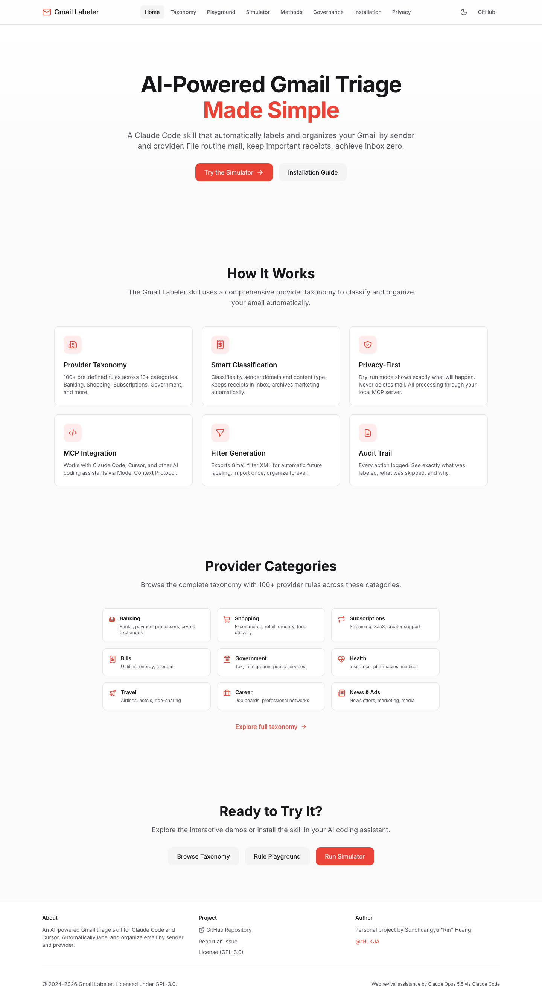
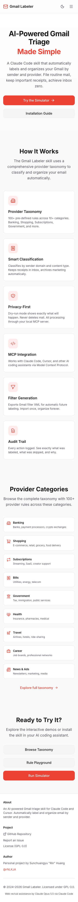
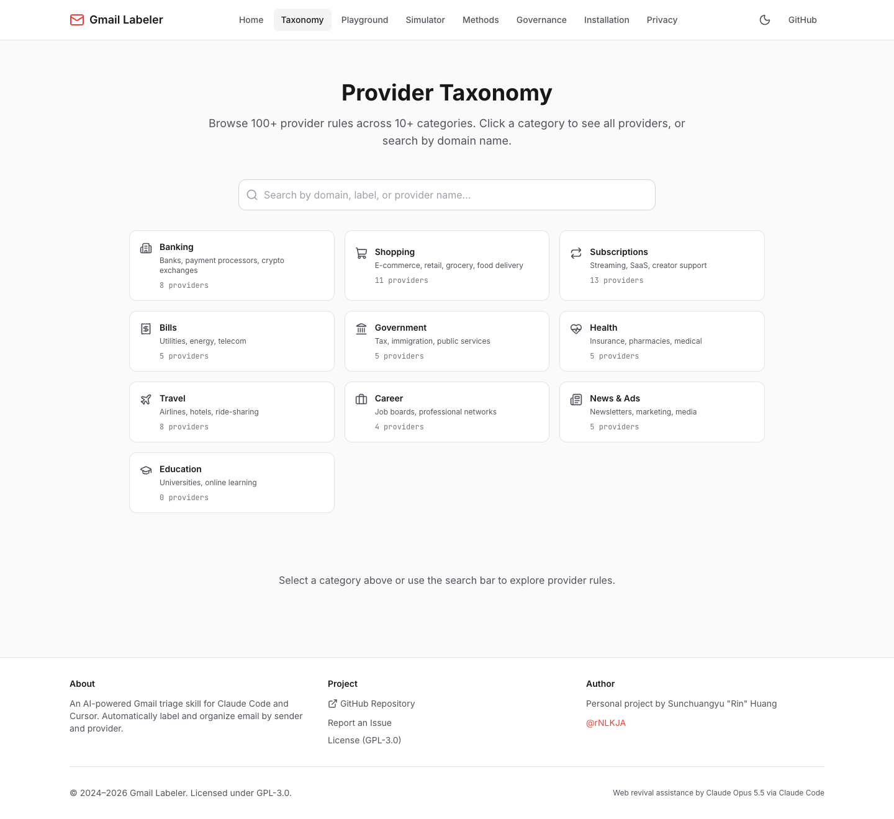
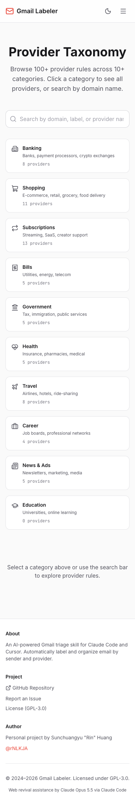

# Gmail Labeler: AI-Powered Email Triage Skill

An intelligent Gmail triage skill for AI coding assistants (Claude Code, Cursor, etc.) that automatically labels and organizes email by sender/provider. This interactive showcase demonstrates the skill's provider taxonomy, classification logic, and dry-run simulation capabilities.

🚀 **[Live Demo](https://gmail-labeler-demo.vercel.app)** | 📽️ **[Product Tour](https://gmail-labeler-demo.vercel.app/tour)**


## Showcase

### Workflow Walkthroughs

**1. Explore the Taxonomy** (~23s)

Browse 20+ provider types, search where domains land, and see example classification rules in action.


**2. Dry-Run Simulator** (~20s)

Load sample inbox data and watch 100 threads get classified with real-time label distribution.


**3. Privacy & Governance** (~33s)

Review the privacy impact assessment, failure modes, and transparent decision records.


### Key Features

| Desktop | Mobile |
|---------|--------|
|  |  |
| **Landing page** - Feature overview and quick navigation | **Mobile-optimized** - Full functionality on 375px+ screens |
|  |  |
| **Provider taxonomy** - 10+ categories, 100+ domains | **Touch-friendly** - Collapsible sections and search |

Full walkthrough with MP4 videos: **[/tour page](https://gmail-labeler-demo.vercel.app/tour)**

## What is Gmail Labeler?

Gmail Labeler is a Claude Code skill that triages your Gmail inbox by automatically classifying senders into provider categories (Banking, Shopping, Subscriptions, Government, etc.) and applying organized labels. It helps you achieve inbox zero by filing routine mail automatically while keeping important receipts and account notices accessible.

**Key features:**
- 🏷️ Provider taxonomy with 100+ pre-defined rules across 10+ categories
- 🔍 Smart classification by sender domain and content type
- 🛡️ Privacy-first: dry-run mode, never deletes or sends mail
- 📋 Generates importable Gmail filter XML
- 🔄 MCP integration for Gmail API access

## This Showcase

This interactive web application demonstrates the skill's design and functionality using synthetic data only—no real Gmail access required.

**Interactive demos:**
1. **Provider Taxonomy Browser** - Explore 10+ categories with 100+ example domains
2. **Rule Playground** - Test classification for any email address
3. **Dry-Run Simulator** - Process a synthetic inbox and see before/after results
4. **Installation Guide** - Step-by-step setup for Claude Code and Cursor
5. **Privacy & Safety** - Understanding data flow and the skill's safeguards

## Tech Stack

### Original Skill
- Python 3.12 with inline script metadata (PEP 723)
- Gmail MCP server integration
- AGENTS.md skill definition format

### Revival Stack (This Showcase)
- **Framework**: Next.js 16 (App Router, React Server Components)
- **Language**: TypeScript (strict mode)
- **Styling**: Tailwind CSS v4
- **UI Components**: Radix UI primitives via shadcn/ui
- **Testing**: Vitest with coverage
- **Deployment**: Vercel (static export)

## Project Structure

```
gmail-labeler/
├── original/                    # Original skill (preserved with git history)
│   ├── .agents/skills/gmail-labeler/
│   │   ├── SKILL.md            # Skill definition
│   │   ├── references/         # Provider rules, setup checklist
│   │   └── scripts/            # Filter generation, validation
│   └── README.md               # Original skill documentation
├── scripts/                     # Data generation
│   └── generate_synthetic_inbox.py  # Creates demo inbox CSV
├── web/                        # Next.js showcase app
│   ├── src/
│   │   ├── app/               # Routes and pages
│   │   ├── components/        # React components
│   │   ├── lib/              # Core logic (ported from original)
│   │   └── hooks/            # Custom React hooks
│   ├── public/data/          # Synthetic inbox data
│   └── package.json          # Dependencies and scripts
├── .github/workflows/ci.yml   # CI pipeline
└── README.md                  # This file
```

## Local Development

### Prerequisites
- Node.js >= 20
- pnpm 10.33+

### Setup

```bash
# Install dependencies
cd web
pnpm install

# Run development server
pnpm dev

# Open http://localhost:3000
```

### Quality Gates

```bash
# Run all checks (must pass before commit)
pnpm lint
pnpm typecheck
pnpm test
pnpm build
```

## Using the Original Skill

See `original/README.md` for detailed installation and usage instructions.

**Quick start:**
1. Install the Gmail MCP server
2. Copy the skill to `.agents/skills/gmail-labeler/`
3. Configure your Gmail API credentials
4. Run in dry-run mode first: "Label my inbox (dry run)"
5. Review the plan, then run for real

## How Data is Generated

The showcase uses 100% synthetic data created by `scripts/generate_synthetic_inbox.py`:
- 100 synthetic email threads
- Sender addresses from real provider domains (Amazon, PayPal, Netflix, etc.)
- Realistic subjects and dates (last 90 days)
- No real personal data

Run the generator:
```bash
# Requires Python 3.12+, uv installed
./scripts/generate_synthetic_inbox.py
# Output: web/public/data/synthetic-inbox.csv
```

## Privacy & Security

**This showcase website:**
- ✅ Uses only synthetic data
- ✅ Never connects to real Gmail
- ✅ Never requests authentication
- ✅ No backend or database
- ✅ All processing happens in your browser

**The original skill:**
- Reads sender, subject, and message body for classification
- Never reads attachment contents
- Never deletes, sends, or marks mail as read
- Requires explicit user confirmation for bulk actions
- All changes logged to `LOG.md`

**⚠️ Important:** The original skill sends email content to your AI provider (Anthropic, OpenAI, etc.) for classification. Use a test account first, and understand your AI provider's data retention policies before processing real mail.

## About This Project

**Type:** Personal productivity tool showcase  
**Year:** 2024-2026  
**Original Author:** Sunchuangyu "Rin" Huang ([@rNLKJA](https://github.com/rNLKJA))  
**License:** GPL-3.0 (copyleft - derivative works must also be GPL-3.0)

This is a personal project demonstrating AI agent skill design and email workflow automation. The web showcase was built to make the skill's classification logic and provider taxonomy accessible without requiring Gmail API setup.

**Repository:** [github.com/rNLKJA/gmail-labeler](https://github.com/rNLKJA/gmail-labeler)

## Contributing

Contributions welcome! See `original/.agents/skills/gmail-labeler/CONTRIBUTING.md` for guidelines.

**Areas for contribution:**
- Additional provider rules (especially non-US/non-AU providers)
- Content type classification improvements
- Gmail filter generation enhancements
- Documentation and examples

## Roadmap

- [ ] Export classified inbox as CSV
- [ ] Visual label hierarchy tree
- [ ] Rule conflict detection UI
- [ ] Multi-language provider taxonomies
- [ ] Outlook/IMAP adapter

## Credits

**Built with:**
- [Next.js](https://nextjs.org) by Vercel
- [Tailwind CSS](https://tailwindcss.com)
- [Radix UI](https://radix-ui.com) primitives
- [Lucide](https://lucide.dev) icons

**Web revival assistance:** Claude Opus 5.5 via [Claude Code](https://claude.com/claude-code)

---

📧 For questions about the original skill or this showcase, open an issue on GitHub.
